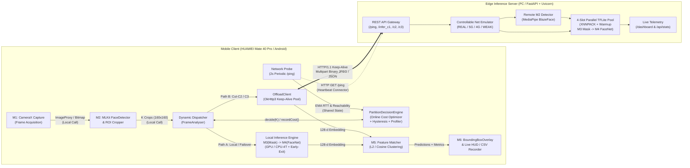

# 运行时动态计算划分系统：Component-and-Connector（C&C）架构与答辩演示指南

> 本文档直接对应《软件架构》课程项目要求 **Part C（100 分满分项）**：
> *“If Part C is finished, the **component-and-connector structure** of the system is required.”*
> *“A **checklist** indicating what you will demonstrate is required; debug at least **10 times** in advance.”*

---

## 1. Component-and-Connector（C&C）运行时架构视图

本系统采用 **移动端感知与决策 + 边缘端并行推理（Mobile-Edge Collaborative C&C Architecture）** 架构，通过明确的 **组件（Components）** 与 **连接件（Connectors）** 实现运行期计算路径的毫秒级自适应切换与断网容错回退。

### 核心组件（Components）与连接件（Connectors）职责表

| 类型 | 名称 | 源码定位 | 核心职责 |
| :--- | :--- | :--- | :--- |
| **Component** | `M1/M2 Preprocessing` | `MainActivity.kt`, `FrameAnalyser.kt` | 相机帧旋转、MLKit 人脸检测与 `160×160` 局部裁剪，完成 **90%~97% 数据降维**。 |
| **Component** | `PartitionDecisionEngine` | `PartitionDecisionEngine.kt` | 运行时在线代价建模、EMA 参数自校准、防抖动迟滞决策与弱网/断网安全回退。 |
| **Component** | `Local Inference Engine` | `FaceNetModel.kt`, `MaskDetectionModel.kt` | 支持 GPU Delegate / 纯 4 线程 CPU 热切换与 **M3-before-M4 戴口罩早退剪枝**。 |
| **Component** | `Edge Parallel Pool` | `cloud-server/inference.py` | 预热 4 槽位 TFLite XNNPACK 解释器池 + `ThreadPoolExecutor`，将多人 $O(K)$ 串行阻塞压低至 $O(\lceil K/4 \rceil)$。 |
| **Component** | `HUD & CSV Telemetry` | `FrameMetrics.kt`, `server.py` | 移动端纳秒级埋点 HUD、双通道 CSV 录制与边缘端 `/dashboard` 实时大屏。 |
| **Connector** | `HTTP Keep-Alive RPC` | `OffloadClient.kt` | 基于 OkHttp3 持久连接池的二进制 `multipart/form-data` 卸载通道，消除 TCP 握手开销。 |
| **Connector** | `Async Heartbeat Probe` | `PartitionDecisionEngine.kt` | 后台协程每 2 秒探测 `/ping`，独立于主推理流水线感知网络 RTT 波动与节点存活。 |
| **Connector** | `Atomic Backpressure Lock` | `FrameAnalyser.kt` | `AtomicBoolean` 帧级背压锁与 `modelLock` 互斥锁，保障高帧率不堆积与热换模零崩溃。 |

---

## 2. 在线代价建模与动态切换机制（Online Cost Model）

每帧在 **M2 检测完成（获得当前人脸数 $K$）** 的切分边界，决策引擎实时求解两条路径的预期计算+通信总耗时：

$$\text{Cost}_{\text{local}}(K) = K \times \bar{t}_{\text{local\_face}}$$

$$\text{Cost}_{\text{offload}}(K, \overline{\text{RTT}}, \hat{B}) = \overline{\text{RTT}} + \frac{K \times \overline{\text{Size}}_{\text{crop}} \times 8192}{\hat{B}} + \left\lceil \frac{K}{P} \right\rceil \times \bar{t}_{\text{edge\_slot}}$$

其中：
* $\bar{t}_{\text{local\_face}}$：端侧单脸推理（M3+M4）EMA 滑动平均耗时（自动感知 GPU/CPU 切换与机身发热降频）；
* $\overline{\text{RTT}}$、$\hat{B}$：后台 2s `/ping` 探针与历史实测卸载帧联合维护的 EMA 往返延迟（ms）与上行带宽（kbps）；
* $P = 4$：边缘端并行推理槽位数；$\bar{t}_{\text{edge\_slot}}$：单槽位实测推理耗时（本机约 10–18 ms）。

### 三重稳定性与容错保障
1. **断网硬回退**：服务端不可达或当帧 HTTP 请求异常时，**当帧立即无缝降级本地执行（In-Frame Failover）**，识别过程零中断。
2. **极端弱网硬回退**：当 $\overline{\text{RTT}} > 300\text{ms}$ 时强制回退 `ALL_LOCAL`，避免长尾卡顿。
3. **防抖动迟滞（Hysteresis, $\delta = 10\text{ms}$）**：仅当目标路径的预期收益超过当前路径 $10\text{ms}$ 以上时才触发切换，杜绝临界点来回震荡。

---

## 3. 四种静态切分方案与动态模式总览

| 模式 | 本地执行模块 | 边缘执行模块 | 典型上传体积 | 核心架构洞察 |
| :--- | :--- | :--- | :--- | :--- |
| **`ALL_LOCAL`** | M1~M6 | 无 | `0 KB` | 离线可用；引入 M3 早退剪枝；但多人同框呈 $O(K)$ 线性卡顿。 |
| **`CUT_C1`** | M1, M5, M6 | M2, M3, M4 | `40~150 KB` | 未降维上传全帧，$K=0$ 仍白传大图，弱网下延迟雪崩。 |
| **`CUT_C2`** | M1, M2, M5, M6 | M3, M4 | `3~5 KB/脸` | **黄金切分点**（漏斗效应缩减 90%~97% 流量），$K=0$ 零发包，多人并行加速比极高。 |
| **`CUT_C3`** | M1, M2, M3, M5, M6 | M4 | `0 或 3~5 KB/脸` | **条件剪枝切分**：本地 M3 拦截戴口罩人脸，实现戴口罩场景零流量与零云端算力。 |
| **`AUTO_DYNAMIC`** | 动态路由 | 动态路由 | 自适应 | 综合 $K$、$\overline{\text{RTT}}$、$\hat{B}$ 与本地算力状态自动寻优，断网无缝本地兜底。 |

---

## 4. 终期 6 分钟现场真机答辩 Demonstration Checklist

> **赛前演练要求**：至少完整预演 **10 次**，提前确认以下准备项：
> - [ ] 华为 Mate 40 Pro 电量 > 50%，USB 连接电脑并执行 `adb reverse tcp:8000 tcp:8000`（双保险防现场 WiFi 干扰）。
> - [ ] PC 端启动 `cloud-server/server.py`，浏览器全屏打开 `http://localhost:8000/dashboard` 投屏。
> - [ ] 手机提前完成人脸底库扫描（打开 App 直接点 `LOAD` 秒加载，现场不要重扫图片）。

| 时间段 | 演示环节 | 现场操作步骤 | 评委直观看到的亮点 |
| :--- | :--- | :--- | :--- |
| **0:00–1:00** | **Part A 基线剖析** | 选 `All-Local`，先测 `GPU` 再切 `CPU-4T`，展示 1 人与多人同框。 | HUD 直观暴露 M4 FaceNet 为 65%+ 算力瓶颈，多人时 FPS 骤降。 |
| **1:00–2:30** | **Part B 漏斗效应对比（C1 vs C2）** | 切 `Cut-C1` 观察大包上传，再切 `Cut-C2`；配合电脑大屏 `/dashboard`。 | `Payload` 从数十 KB 暴跌至 `3~5 KB`（缩减 95%+），边缘纯推理仅 ~10ms，FPS 跃升。 |
| **2:30–3:30** | **架构洞察：C3 条件早退剪枝** | 切 `Cut-C3`，戴上口罩或用手遮住口鼻。 | HUD 显示 `C3 pruned masked face locally (0 KB)`，电脑大屏请求数为 0。 |
| **3:30–5:15** | **Part C 动态划分三大触发场景** | 切 `Auto-Dynamic`：① `REAL` 好网下自动卸载 `Auto->C2`；② 点 `⚙` 切 `SIM_WEAK` 瞬间自动回退 `Auto->Local`；③ 切回 `SIM_4G` 展示 1 人本地 / 2 人同框自动切 `Auto->C2`；④ 现场关停服务端，展示无感本地兜底！ | 完整展现 **负载感知 + 弱网自适应 + 断网容错**，全链路零崩溃。 |
| **5:15–6:00** | **总结与核心数据图表回顾** | 展示基于真机 CSV 录制的对比图表与架构结论。 | 数据真实可复现，理论与工程完美闭环。 |
